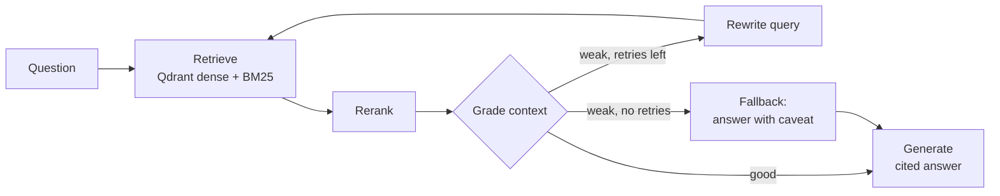

# Agentic RAG with a Measured Eval Harness

Self-correcting RAG agent built with **LangGraph**: it retrieves with hybrid search
(dense + BM25), grades the retrieved context, rewrites the query and retries when
the context is weak, and only then generates a cited answer. Every design change is
judged by an **eval harness** (ragas + retrieval metrics), not by vibes — the README
table below is the scoreboard.

## Why this project

Built as an MLE portfolio piece. It demonstrates, with numbers:

- **Retrieval engineering** — chunking, hybrid dense/sparse retrieval, reranking
- **Agent design** — a LangGraph state machine with a self-correction loop
- **Evaluation methodology** — a fixed question set, baseline vs. improved runs,
  faithfulness / answer relevance / context precision tracked per change
- **Serving** — FastAPI endpoint, Docker, CI

## Architecture



## Stack

| Piece | Choice | Skill it shows |
|---|---|---|
| Agent loop | LangGraph | agent state machines |
| Vector store | Qdrant | vector databases |
| Sparse retrieval | rank-bm25 + RRF merge | hybrid search |
| Reranker | cross-encoder (sentence-transformers) | retrieval quality |
| Eval | ragas + custom retrieval metrics | offline evaluation |
| Tracing | Langfuse (optional) | observability |
| Serving | FastAPI + Docker | deployment basics |
| CI | GitHub Actions (ruff + pytest) | engineering hygiene |

## Quickstart

```bash
# 1. Vector store
docker compose up -d qdrant

# 2. Install
python -m venv .venv && source .venv/bin/activate
pip install -e ".[dev,eval]"
cp .env.example .env   # fill in OPENAI_API_KEY

# 3. Put source documents in data/raw/ (PDF / md / txt), then index them
python -m agentic_rag.ingest

# 4. Ask something
uvicorn agentic_rag.api:app --reload
curl -s localhost:8000/ask -H 'content-type: application/json' \
  -d '{"question": "your question here"}'
```

## Eval results

Question set: `evals/questions.jsonl` (goal: 30–50 questions with known sources).
Run: `python -m evals.run_eval` → writes a table under `evals/results/`.

| Run | Change | Hit@5 | MRR | Faithfulness | Answer relevance | Context precision |
|---|---|---|---|---|---|---|
| 0 | Naive RAG baseline (dense only, no loop) | – | – | – | – | – |
| 1 | + Hybrid retrieval (BM25 + RRF) | – | – | – | – | – |
| 2 | + Reranker | – | – | – | – | – |
| 3 | + Self-correction loop (grade → rewrite) | – | – | – | – | – |

## Repo layout

```
src/agentic_rag/   config, ingest, retriever, graph (LangGraph), api (FastAPI)
evals/             question set + eval harness + results
data/raw/          source documents (PDFs are git-ignored)
tests/             smoke tests
PLAN.md            day-by-day build plan
```

## Status

- [ ] Day 1 — ingest + naive RAG baseline + first eval numbers
- [ ] Day 2 — hybrid retrieval, reranker, self-correction loop, tracing
- [ ] Day 3 — full eval runs, results table, demo polish
